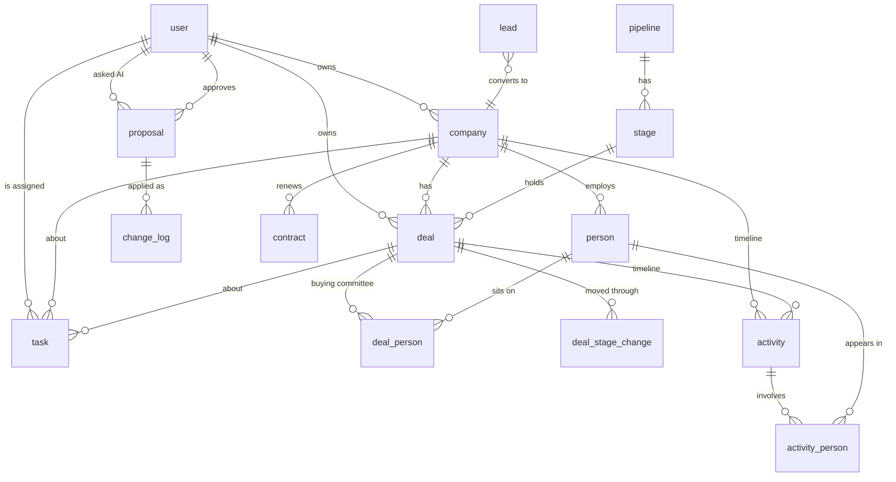

# Open Sales: data model

The Postgres schema for the features in [features.md](features.md), with the
indexes each screen needs. **Status: proposal for review.** Only `workspace`,
`instance_setting` and Better Auth's tables exist so far
(`apps/server/src/db/schema.ts`). Migrations only ever add, so a table or
column here is hard to take back once it ships: review this before it becomes
Drizzle code.

## Ground rules

These apply to every table below.

1. **One workspace per server.** Self-host only, so there's no tenant column
   and no `workspace_id` in every index.
2. **Names.** Tables are singular snake_case, like the existing `workspace` and
   `user`. The companies we sell to are the `company` table, shown as
   "Accounts" in the app: Better Auth already owns a table called `account`
   (sign-in accounts). Contacts are `person`.
3. **IDs.** UUIDv7, made by the server (`Bun.randomUUIDv7()`). They sort by
   creation time, so new rows land at the end of an index instead of at random
   pages, and an id alone is a stable tiebreaker for paging. Better Auth's
   `user.id` stays text. Append-only logs use `bigint generated always as
identity`.
4. **Time.** `timestamptz` for moments (`created_at`, `updated_at`,
   `occurred_at`); `date` for calendar days (`close_date`, `due_on`,
   `renews_on`).
5. **Archive, don't delete.** Records people work with get `archived_at`.
   Proposals, history and AI citations keep pointing at archived rows. Hot
   indexes are partial (`where archived_at is null`), so archived rows cost
   nothing in daily lists. Hard delete is a later admin purge.
6. **Versions.** Editable records (`company`, `person`, `deal`, `task`) carry
   `version integer not null default 1`, bumped on every write. A proposal
   stores the version it was made against; if it changed, the card shows
   "Changed since". The same check stops two people overwriting each other.
7. **Money.** `bigint` minor units (cents) plus `currency char(3)`. Never
   floats.
8. **Enums.** `pgEnum` for closed sets the code branches on (statuses, kinds):
   adding a value is a safe, additive migration. Plain `text` for open sets
   (source, industry).
9. **Custom fields.** One `custom_fields jsonb not null default '{}'` column on
   `company`, `person` and `deal`, keyed by the field's `key`. Definitions live
   in `custom_field`. A GIN index (`jsonb_path_ops`) serves filters like
   `custom_fields @> '{"region":"EMEA"}'`. The API validates values against the
   definitions; Postgres stores them.
10. **Search.** `pg_trgm` GIN indexes on names, emails and domains, for ⌘K
    and "matches as you type". Full-text search over activity bodies comes with
    email sync (P1).
11. **Foreign keys are always indexed.** Postgres doesn't do it automatically,
    and unindexed foreign keys make archiving and joins slow. Default
    `on delete restrict` (we archive instead); join tables `cascade`.
12. **Paging is keyset**, not offset: `where (sort_col, id) < ($1, $2) order
by sort_col desc, id desc limit 50`. So list indexes end with `id`.
13. **Permissions live in the API**, not Postgres row-level security. Members
    read everything and write only what they own; `owner_id` indexes make
    "mine" fast.
14. **Some values are copied for speed**, and the API updates them in the same
    transaction as the change that moves them: `deal.status` (from its stage),
    `deal.stage_entered_at`, and `last_activity_at` on company, person and
    deal.

## Overview

## Tables

Columns marked **P1** or **P2** can wait for their feature; everything else
is in the first migration. Every table also has `created_at` and, if editable,
`updated_at`; they're left out below.

### Setup

**`workspace`** (exists): add

| Column      | Type    | Notes                                        |
| ----------- | ------- | -------------------------------------------- |
| `currency`  | char(3) | Default for new deals. `'USD'` until set.    |
| `time_zone` | text    | IANA name, for "due today" and report weeks. |

Branding (product name, logo, colour) joins it with white labelling (P1).

**`invite`**: Invite teammates (P0).

| Column          | Type        | Notes                                                 |
| --------------- | ----------- | ----------------------------------------------------- |
| `id`            | uuid        |                                                       |
| `email`         | text        |                                                       |
| `role`          | text        | Same check as `user.role`.                            |
| `token_hash`    | text        | SHA-256 of the link's token; the token is shown once. |
| `invited_by_id` | text → user |                                                       |
| `expires_at`    | timestamptz |                                                       |
| `accepted_at`   | timestamptz | Null until used.                                      |

Indexes: unique `token_hash`; unique `lower(email) where accepted_at is null`
(one open invite per address).

**`custom_field`** (P1, but the jsonb columns exist from day one)

| Column        | Type        | Notes                                                 |
| ------------- | ----------- | ----------------------------------------------------- |
| `id`          | uuid        |                                                       |
| `entity`      | enum        | `company`, `person`, `deal`                           |
| `key`         | text        | Stable slug used in `custom_fields`.                  |
| `label`       | text        |                                                       |
| `type`        | enum        | `text`, `number`, `money`, `date`, `select`, `person` |
| `options`     | jsonb       | Choices for `select`.                                 |
| `position`    | integer     | Order in forms.                                       |
| `archived_at` | timestamptz |                                                       |

Indexes: unique `(entity, key)`.

### Pipeline

**`pipeline`**: one row ("Sales") from setup; several pipelines are P2, but
the table exists now so deals never need moving.

| Column       | Type    | Notes        |
| ------------ | ------- | ------------ |
| `id`         | uuid    |              |
| `name`       | text    |              |
| `position`   | integer |              |
| `is_default` | boolean | Exactly one. |

Indexes: unique `(is_default) where is_default`.

**`stage`**

| Column               | Type            | Notes                                                                 |
| -------------------- | --------------- | --------------------------------------------------------------------- |
| `id`                 | uuid            |                                                                       |
| `pipeline_id`        | uuid → pipeline |                                                                       |
| `name`               | text            |                                                                       |
| `position`           | integer         | Not unique: reordering rewrites positions in one transaction.         |
| `kind`               | enum            | `open`, `won`, `lost`. Won and Lost exist once per pipeline.          |
| `win_probability`    | smallint        | 0–100, for forecasts.                                                 |
| `stalled_after_days` | integer         | Null means never stalls.                                              |
| `goal`               | text            | Plain words the AI reads.                                             |
| `exit_criteria`      | text            | "Pricing sent and budget confirmed": the AI proposes moves from this. |
| `archived_at`        | timestamptz     |                                                                       |

Indexes: `(pipeline_id, position)`; unique `(pipeline_id, kind) where kind in
('won','lost')`.

**`lost_reason`**: `id`, `label`, `position`, `archived_at`.

### Records

**`company`**: "Accounts" in the app.

| Column             | Type              | Notes                                                           |
| ------------------ | ----------------- | --------------------------------------------------------------- |
| `id`               | uuid              |                                                                 |
| `name`             | text              |                                                                 |
| `domain`           | text              | `halden.com`, lower case, no `www.`. Matches imports and email. |
| `owner_id`         | text → user       | Exactly one owner. Not null.                                    |
| `industry`         | text              |                                                                 |
| `description`      | text              |                                                                 |
| `custom_fields`    | jsonb             |                                                                 |
| `source`           | text              | `manual`, `import`, `lead`, `email` …                           |
| `import_id`        | uuid → import_job | Set when an import created it, for undo.                        |
| `last_activity_at` | timestamptz       | Copied; sorts lists and finds quiet accounts.                   |
| `version`          | integer           |                                                                 |
| `archived_at`      | timestamptz       |                                                                 |

Indexes:

- `(owner_id, name, id) where archived_at is null`: "My accounts", A–Z.
- `(name, id) where archived_at is null`: everyone's list, A–Z.
- `(last_activity_at desc, id) where archived_at is null`: recently active and quiet accounts.
- unique `(domain) where domain is not null and archived_at is null`: one company per domain; the duplicate check for imports and lead conversion.
- GIN `name gin_trgm_ops`: search.
- GIN `custom_fields jsonb_path_ops`: custom field filters.
- `(import_id) where import_id is not null`.

**`person`**: contacts.

| Column                                                              | Type           | Notes                                                        |
| ------------------------------------------------------------------- | -------------- | ------------------------------------------------------------ |
| `id`                                                                | uuid           |                                                              |
| `company_id`                                                        | uuid → company | Null allowed: a contact can exist before their company does. |
| `name`                                                              | text           | One field; people's names don't split cleanly.               |
| `title`                                                             | text           |                                                              |
| `email`                                                             | text           | Stored lower case.                                           |
| `phone`                                                             | text           |                                                              |
| `linkedin_url`                                                      | text           |                                                              |
| `created_by_id`                                                     | text → user    | Edits people with no company, with managers.                 |
| `custom_fields`                                                     | jsonb          |                                                              |
| `source`, `import_id`, `last_activity_at`, `version`, `archived_at` |                | As on company.                                               |

Who can change a person: the owner of their company, or managers and admins.
With no company, whoever created them. So there's no `owner_id` to keep in
sync when a company changes hands.

Indexes:

- `(company_id, name, id) where archived_at is null`: a company's People tab.
- unique `(email) where email is not null and archived_at is null`: duplicates, and matching email senders to people.
- GIN `name gin_trgm_ops`, GIN `email gin_trgm_ops`: search.
- GIN `custom_fields jsonb_path_ops`; `(import_id) where import_id is not null`.

**`deal`**

| Column                                                                               | Type               | Notes                                                                       |
| ------------------------------------------------------------------------------------ | ------------------ | --------------------------------------------------------------------------- |
| `id`                                                                                 | uuid               |                                                                             |
| `company_id`                                                                         | uuid → company     | Not null.                                                                   |
| `name`                                                                               | text               |                                                                             |
| `owner_id`                                                                           | text → user        | Starts as the company's owner; moves with it on "reassign with open deals". |
| `pipeline_id`                                                                        | uuid → pipeline    |                                                                             |
| `stage_id`                                                                           | uuid → stage       |                                                                             |
| `status`                                                                             | enum               | `open`, `won`, `lost`. Copied from the stage's kind.                        |
| `value_minor`                                                                        | bigint             | Null until known.                                                           |
| `currency`                                                                           | char(3)            |                                                                             |
| `close_date`                                                                         | date               | Expected while open; actual once closed.                                    |
| `next_step`                                                                          | text               |                                                                             |
| `stage_entered_at`                                                                   | timestamptz        | Copied; drives "idle 12 days".                                              |
| `closed_at`                                                                          | timestamptz        |                                                                             |
| `lost_reason_id`                                                                     | uuid → lost_reason |                                                                             |
| `lost_note`                                                                          | text               |                                                                             |
| `kind`                                                                               | enum               | `new`, `renewal`.                                                           |
| `contract_id`                                                                        | uuid → contract    | **P1**: the contract a renewal deal renews.                                 |
| `custom_fields`, `source`, `import_id`, `last_activity_at`, `version`, `archived_at` |                    | As on company.                                                              |

Indexes:

- `(pipeline_id, stage_id, last_activity_at desc, id) where status = 'open' and archived_at is null`: the board, column by column, with per-column count and value.
- `(owner_id, status, close_date) where archived_at is null`: "My deals" and the forecast.
- `(company_id, status) where archived_at is null`: a company's Deals tab.
- `(close_date) where status = 'open' and archived_at is null`: forecast by month, "closing this month".
- `(stage_entered_at) where status = 'open' and archived_at is null`: deals needing a nudge (compared with the stage's `stalled_after_days`).
- `(closed_at) where status in ('won','lost')`: won and lost reports by period.
- `(lost_reason_id) where status = 'lost'`; GIN `name gin_trgm_ops`; GIN `custom_fields jsonb_path_ops`; `(import_id) where import_id is not null`.

**`deal_person`**: the buying committee.

| Column      | Type          | Notes                                                          |
| ----------- | ------------- | -------------------------------------------------------------- |
| `deal_id`   | uuid → deal   | Cascade.                                                       |
| `person_id` | uuid → person | Cascade.                                                       |
| `role`      | enum          | `champion`, `decision_maker`, `evaluator`, `blocker`, or null. |

Primary key `(deal_id, person_id)`; index `(person_id)`.

**`deal_stage_change`**: every stage move, for conversion between stages and
time in stage. Append-only.

| Column          | Type            | Notes              |
| --------------- | --------------- | ------------------ |
| `id`            | bigint identity |                    |
| `deal_id`       | uuid → deal     |                    |
| `from_stage_id` | uuid → stage    | Null when created. |
| `to_stage_id`   | uuid → stage    |                    |
| `changed_at`    | timestamptz     |                    |
| `changed_by_id` | text → user     |                    |

Indexes: `(deal_id, changed_at)`; `(to_stage_id, changed_at)`: "how many
reached Proposal this quarter".

**`contract`** (P1): what a renewal renews.

| Column                    | Type           | Notes                                    |
| ------------------------- | -------------- | ---------------------------------------- |
| `id`                      | uuid           |                                          |
| `company_id`              | uuid → company |                                          |
| `deal_id`                 | uuid → deal    | The won deal that started it.            |
| `value_minor`, `currency` |                |                                          |
| `starts_on`               | date           |                                          |
| `renews_on`               | date           |                                          |
| `status`                  | enum           | `active`, `renewing`, `renewed`, `ended` |
| `end_reason`              | text           | "Won't renew" reason.                    |

Indexes: `(renews_on) where status = 'active'`: renewals in the next 30, 60
or 90 days; `(company_id)`; `(deal_id)`.

**`lead`**: the Leads inbox.

| Column                                                             | Type              | Notes                                           |
| ------------------------------------------------------------------ | ----------------- | ----------------------------------------------- |
| `id`                                                               | uuid              |                                                 |
| `name`, `email`, `phone`, `company_name`, `title`                  | text              |                                                 |
| `message`                                                          | text              | What they wrote.                                |
| `source`                                                           | text              | `import`, `web_form`, `email`, `manual`         |
| `status`                                                           | enum              | `new`, `qualified`, `disqualified`, `converted` |
| `owner_id`                                                         | text → user       | Null until assigned.                            |
| `fit_note`                                                         | text              | The AI's note on fit.                           |
| `disqualified_reason`                                              | text              |                                                 |
| `converted_company_id`, `converted_person_id`, `converted_deal_id` | uuid              | Set on convert.                                 |
| `raw`                                                              | jsonb             | The original row or form post.                  |
| `import_id`                                                        | uuid → import_job | Set when an import created it, for undo.        |

Indexes: `(status, created_at desc, id)`: the inbox; `(owner_id, status)`;
`(email)`: matching to existing people on convert; `(import_id) where
import_id is not null`.

### Timeline

**`activity`**: notes, calls, meetings and emails, in one stream.

| Column        | Type           | Notes                                                              |
| ------------- | -------------- | ------------------------------------------------------------------ |
| `id`          | uuid           |                                                                    |
| `type`        | enum           | `note`, `call`, `meeting`, `email`                                 |
| `occurred_at` | timestamptz    | When it happened, or starts. Future values are "upcoming".         |
| `ends_at`     | timestamptz    | Meetings.                                                          |
| `company_id`  | uuid → company | The timeline it belongs to. Null only for emails not yet matched.  |
| `deal_id`     | uuid → deal    | Also shown on this deal.                                           |
| `author_id`   | text → user    | Who wrote or logged it; null for synced emails.                    |
| `source`      | enum           | `manual`, `ai`, `email_sync`, `calendar_sync`, `import`            |
| `title`       | text           | Subject, meeting name, call summary.                               |
| `body`        | text           | Note text, call notes, email body (if the sharing setting allows). |
| `data`        | jsonb          | Per type: call outcome and duration, meeting link …                |
| `archived_at` | timestamptz    |                                                                    |

Indexes:

- `(company_id, occurred_at desc, id) where archived_at is null`: a company's timeline (and its upcoming items, read the other way).
- `(deal_id, occurred_at desc, id) where deal_id is not null and archived_at is null`: a deal's timeline.
- `(author_id, occurred_at desc)`: activity reports per person.
- **P1**: GIN full-text `to_tsvector('simple', coalesce(title,'') || ' ' || coalesce(body,''))`, so the AI and search can find "pricing" across emails and notes.

**`activity_person`**: who an activity involved (attendees, recipients).

`activity_id` → activity (cascade), `person_id` → person (cascade); primary
key `(activity_id, person_id)`; index `(person_id, activity_id)`: a person's
timeline and "last contacted".

**`email_message`** (P1): the email-specific part of an `email` activity.

| Column                                         | Type            | Notes                    |
| ---------------------------------------------- | --------------- | ------------------------ |
| `activity_id`                                  | uuid → activity | Primary key.             |
| `message_id`                                   | text            | The `Message-ID` header. |
| `thread_id`                                    | text            |                          |
| `direction`                                    | enum            | `inbound`, `outbound`    |
| `from_address`, `to_addresses`, `cc_addresses` | text, text[]    |                          |
| `sent_at`                                      | timestamptz     |                          |

Indexes: unique `(message_id)`: sync never imports a message twice;
`(thread_id, sent_at)`.

**`task`**

| Column                               | Type            | Notes                             |
| ------------------------------------ | --------------- | --------------------------------- |
| `id`                                 | uuid            |                                   |
| `title`                              | text            |                                   |
| `notes`                              | text            |                                   |
| `due_on`                             | date            | Null means no date.               |
| `assignee_id`                        | text → user     |                                   |
| `created_by_id`                      | text → user     |                                   |
| `company_id`, `deal_id`, `person_id` | uuid            | What it's about. Any may be null. |
| `completed_at`                       | timestamptz     |                                   |
| `source`                             | enum            | `manual`, `ai`                    |
| `proposal_id`                        | uuid → proposal | The proposal that created it.     |
| `version`, `archived_at`             |                 |                                   |

Indexes: `(assignee_id, due_on, id) where completed_at is null and archived_at
is null`: Today's follow-ups due and overdue; `(company_id) where
completed_at is null`; `(deal_id) where completed_at is null`.

**`attachment`** (P1): files on deal status notes and activities.

`id`, `name`, `mime_type`, `size_bytes bigint`, `storage_key` (where the bytes
are), `company_id`, `deal_id`, `activity_id`, `uploaded_by_id`,
`archived_at`. Indexes: `(deal_id)`, `(activity_id)`, `(company_id)`.

### AI

**`proposal`**: the heart of approve-first AI.

| Column            | Type                | Notes                                                                                                |
| ----------------- | ------------------- | ---------------------------------------------------------------------------------------------------- |
| `id`              | uuid                |                                                                                                      |
| `kind`            | enum                | `update`, `create`, `archive`, `email_draft`                                                         |
| `status`          | enum                | `pending`, `approved`, `declined`, `out_of_date`, `undone`                                           |
| `target_type`     | enum                | `company`, `person`, `deal`, `task`, `activity`                                                      |
| `target_id`       | uuid                | Null for `create`.                                                                                   |
| `base_version`    | integer             | The target's version when proposed: the "Changed since" check.                                       |
| `changes`         | jsonb               | `[{ field, from, to }]` for updates; the new record for creates; `{ to, subject, body }` for drafts. |
| `title`           | text                | "Move Halden Capital to Proposal".                                                                   |
| `why`             | text                | The one-line reason shown on the card.                                                               |
| `sources`         | jsonb               | `[{ type, id }]`: the email, note or record behind it.                                               |
| `requested_by_id` | text → user         | Whose AI made it.                                                                                    |
| `approver_id`     | text → user         | Who decides: the requester, or the owner on "send to owner".                                         |
| `engine`          | enum                | `claude-code`, `codex`                                                                               |
| `playbook_run_id` | uuid → playbook_run | **P1**                                                                                               |
| `decided_by_id`   | text → user         |                                                                                                      |
| `decided_at`      | timestamptz         |                                                                                                      |
| `decline_reason`  | text                |                                                                                                      |
| `undo_until`      | timestamptz         | Set on approve.                                                                                      |

Indexes:

- `(approver_id, created_at desc, id) where status = 'pending'`: **Waiting for you**, the busiest query in the app, and the sidebar count.
- `(target_type, target_id) where status = 'pending'`: pending cards on a record, and marking them out of date when it changes.
- `(requested_by_id, created_at desc)`: "what my AI did".
- `(status, created_at)`: cleanup of old declined proposals.

**`playbook`, `playbook_version`, `playbook_run`** (P1)

- `playbook`: `id`, `name`, `description`, `author_id`, `current_version_id`, `archived_at`.
- `playbook_version`: `id`, `playbook_id`, `version integer`, `steps text`, `blanks jsonb`, `allowed_changes jsonb`, `created_by_id`. Unique `(playbook_id, version)`.
- `playbook_run`: `id`, `playbook_version_id`, `run_by_id`, `target_type`, `target_id`, `engine`, `blank_answers jsonb`, `status`, `started_at`, `finished_at`. Indexes `(playbook_version_id, started_at desc)` (how often it's used), `(target_type, target_id)`.

### History and jobs

**`change_log`**: every write, by anyone or anything. Append-only, the
largest table after `activity`.

| Column        | Type            | Notes                                                                  |
| ------------- | --------------- | ---------------------------------------------------------------------- |
| `id`          | bigint identity | Order of writes.                                                       |
| `occurred_at` | timestamptz     |                                                                        |
| `actor_id`    | text → user     | Null for the system.                                                   |
| `via`         | enum            | `app`, `ai_proposal`, `import`, `api`, `system`                        |
| `proposal_id` | uuid → proposal | Set when an approved proposal made the change: "AI, approved by Asha". |
| `record_type` | enum            | Same set as `proposal.target_type`, plus `stage`, `user` …             |
| `record_id`   | text            | Text, since `user` ids aren't uuids.                                   |
| `action`      | enum            | `create`, `update`, `archive`, `restore`                               |
| `changes`     | jsonb           | `[{ field, from, to }]`                                                |

Indexes: `(record_type, record_id, id desc)`: field changes on a record's
timeline; `(actor_id, id desc)`; BRIN `(occurred_at)`: the audit log by date,
tiny and fine for append-only data. When it passes about 10 million rows,
partition it by month.

**`import_job`**: CSV import (P0) and undo (P1).

| Column           | Type        | Notes                                                      |
| ---------------- | ----------- | ---------------------------------------------------------- |
| `id`             | uuid        |                                                            |
| `entity`         | enum        | `company`, `person`, `deal`, `lead`, `mixed`               |
| `file_name`      | text        |                                                            |
| `status`         | enum        | `mapping`, `queued`, `running`, `done`, `failed`, `undone` |
| `mapping`        | jsonb       | CSV column → field.                                        |
| `options`        | jsonb       | Duplicates, owner, stage choices.                          |
| `counts`         | jsonb       | `{ created, updated, skipped, failed }`                    |
| `error_file_key` | text        | The downloadable error rows.                               |
| `created_by_id`  | text → user |                                                            |
| `finished_at`    | timestamptz |                                                            |

Indexes: `(created_by_id, created_at desc)`. The work itself runs in pg-boss,
which keeps its own tables in its own schema.

**`saved_view`** (P1): `id`, `entity`, `name`, `owner_id`, `is_shared`,
`filters jsonb`, `columns jsonb`, `sort jsonb`. Index `(entity, owner_id)`;
`(entity) where is_shared`.

**`notification`** (P1): `id`, `user_id`, `kind`, `record_type`,
`record_id`, `read_at`. Index `(user_id, created_at desc) where read_at is
null`.

## Busy queries and the index that serves each

| Screen or job                         | Query shape                                                        | Index                                                       |
| ------------------------------------- | ------------------------------------------------------------------ | ----------------------------------------------------------- |
| Today: Waiting for you, sidebar count | pending proposals for me, newest first                             | `proposal (approver_id, created_at desc, id) where pending` |
| Today: Follow-ups due                 | my open tasks due on or before today                               | `task (assignee_id, due_on, id) where open`                 |
| Today: Deals needing a nudge          | open deals whose `stage_entered_at` is older than the stage allows | `deal (stage_entered_at) where open`                        |
| Pipeline board                        | open deals in a pipeline, grouped by stage, with count and sum     | `deal (pipeline_id, stage_id, …) where open`                |
| My deals                              | my deals by status and close date                                  | `deal (owner_id, status, close_date)`                       |
| Accounts list, mine first             | my companies A–Z, paged                                            | `company (owner_id, name, id)`                              |
| Account page timeline                 | activities for a company, newest first, upcoming on top            | `activity (company_id, occurred_at desc, id)`               |
| Person page timeline                  | activities involving a person                                      | `activity_person (person_id, activity_id)`                  |
| Field changes on a timeline           | change log for a record                                            | `change_log (record_type, record_id, id desc)`              |
| ⌘K search                             | name, email or domain contains "hald"                              | trigram GIN on company, person, deal names; person email    |
| Import and lead duplicates            | company by domain, person by email                                 | unique `company (domain)`, unique `person (email)`          |
| Forecast                              | open deals by close month, weighted by stage                       | `deal (close_date) where open`                              |
| Won and lost report                   | deals closed in a period, by reason                                | `deal (closed_at) where won or lost`                        |
| Stage conversion                      | how many deals entered each stage in a period                      | `deal_stage_change (to_stage_id, changed_at)`               |
| Renewals                              | active contracts renewing in the next 90 days                      | `contract (renews_on) where active`                         |
| Leads inbox                           | new leads, newest first                                            | `lead (status, created_at desc, id)`                        |
| Proposal goes out of date             | pending proposals on the record just changed                       | `proposal (target_type, target_id) where pending`           |

## Rollout

Migrations, in order. Each is additive.

1. **`add-core-records`** (P0): extension `pg_trgm`; `workspace.currency`,
   `workspace.time_zone`; `invite`; `pipeline`, `stage`, `lost_reason` (with
   the default pipeline and stages as seed rows); `company`, `person`, `deal`,
   `deal_person`, `deal_stage_change`; `activity`, `activity_person`, `task`;
   `lead`; `proposal`; `change_log`; `import_job`. All the indexes above for
   these tables.
2. **`add-custom-fields`** (P1): `custom_field`. The jsonb columns are already
   there.
3. **`add-email-and-files`** (P1): `email_message`, `attachment`, the
   full-text index on `activity`.
4. **`add-renewals`** (P1): `contract`, `deal.contract_id`.
5. **`add-playbooks`** (P1): `playbook`, `playbook_version`, `playbook_run`,
   `proposal.playbook_run_id`.
6. **`add-views-and-notifications`** (P1): `saved_view`, `notification`.

Sizes to design for: a small team, up to about 100,000 companies and people,
50,000 deals and a few million activities once email sync is on. Every list
above is an index scan at that size; nothing needs a cache or a search
service.

## Open questions

1. **People without a company.** Above, their creator and managers can edit
   them. Or should every person need a company?
2. **Where files live.** A Docker volume on the server (simplest), S3-style
   storage (scales, one more thing to set up), or Postgres `bytea` (one
   backup, but bloats the database). Suggested: a volume first, behind a
   storage interface.
3. **Email bodies.** With "metadata only" sharing, should the server store the
   body at all? Not storing it is safest, but the AI then can't read it for
   anyone, including the owner.
4. **Purging.** Archived records stay forever until an admin purges them. Do
   we need a GDPR-style "erase this person everywhere" in the first release?
