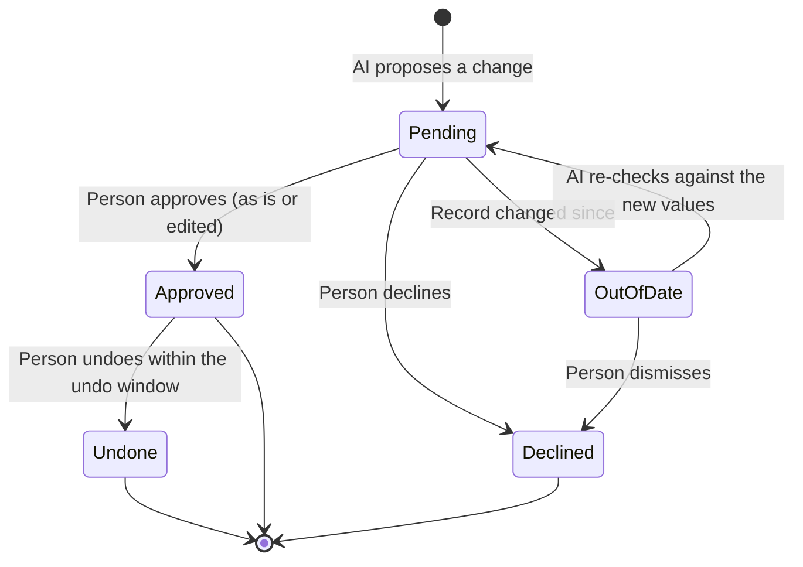

# Open Sales: user flows

Step-by-step journeys through the product. Features are listed in
[features.md](features.md). Each flow says who does it, where it starts, the
steps, what the AI does, and what can go wrong.

## Flow index

| #   | Flow                                                                          | Who            | Priority |
| --- | ----------------------------------------------------------------------------- | -------------- | -------- |
| 1   | [Set up the server](#1-set-up-the-server)                                     | Admin          | P0       |
| 2   | [Invite the team](#2-invite-the-team)                                         | Admin          | P0       |
| 3   | [First launch of the app](#3-first-launch-of-the-app)                         | All            | P0       |
| 4   | [Import a spreadsheet](#4-import-a-spreadsheet)                               | Admin, Manager | P0       |
| 5   | [Set up pipeline stages](#5-set-up-pipeline-stages)                           | Admin          | P0       |
| 6   | [Start the day on Today](#6-start-the-day-on-today)                           | All            | P0       |
| 7   | [Review an AI proposal](#7-review-an-ai-proposal)                             | All            | P0       |
| 8   | [Log a call from notes](#8-log-a-call-from-notes)                             | All            | P0       |
| 9   | [Send a follow-up email](#9-send-a-follow-up-email)                           | All            | P0       |
| 10  | [Create a deal and move it along](#10-create-a-deal-and-move-it-along)        | All            | P0       |
| 11  | [Close a deal as won or lost](#11-close-a-deal-as-won-or-lost)                | All            | P0       |
| 12  | [Work new leads](#12-work-new-leads)                                          | All            | P0       |
| 13  | [Prepare for a meeting](#13-prepare-for-a-meeting)                            | All            | P1       |
| 14  | [Handle a renewal](#14-handle-a-renewal)                                      | All            | P1       |
| 15  | [Review the team's pipeline](#15-review-the-teams-pipeline)                   | Manager        | P1       |
| 16  | [Write and run a playbook](#16-write-and-run-a-playbook)                      | Manager, All   | P1       |
| 17  | [Ask about a report](#17-ask-about-a-report)                                  | All            | P1       |
| 18  | [Change an account you don't own](#18-change-an-account-you-dont-own)         | Member         | P1       |
| 19  | [When the AI tool isn't available](#19-when-the-ai-tool-isnt-available)       | All            | P0       |
| 20  | [Brand it as your own](#20-brand-it-as-your-own)                              | Admin          | P1       |
| 21  | [Build a branded desktop app](#21-build-a-branded-desktop-app)                | Admin          | P2       |
| 22  | [Capture from your own mailbox](#22-capture-from-your-own-mailbox) (proposed) | All            | P1       |

## The proposal lifecycle

Most flows end in a proposal. This is how one moves:

The server checks the person's role at two points: when the proposal is
created, and again when it's approved.

---

## Setup

### 1. Set up the server

**Who:** Admin · **Starts from:** a terminal on the company's server, then the
desktop app. First-run happens in the app; the server has no web pages.

1. Clone the repo (or download the compose file) and run `docker compose up -d`.
2. The server starts Postgres, runs migrations, makes its own sign-in secret
   (unless `AUTH_SECRET` is set), and answers at `/api/v1/health`.
3. The admin opens the desktop app and enters the server's address (flow 3,
   step 1).
4. The server has no accounts yet, so the app shows **Create the admin
   account**: workspace name, their name, work email and password (at least 8
   characters).
5. **Create account** makes the workspace and its first admin, and signs them
   in straight away. They land in the app.

**AI:** none.

**Built (sign-in slice):** steps 1 to 5. The logo comes later, with branding
settings.

**Edge cases**

- Two people set up at once: the server lets only the first one through
  (setup holds a database lock), and the other sees "This server is already
  set up."
- Someone else reaches a new server first: they become its admin. Keep a new
  server on a private network until setup is done.
- Open sign-up is switched off: new people join by invite (flow 2), never by
  signing themselves up.
- The database can't start: the server exits with a clear message and Docker
  restarts it until the database answers.

**Mobbin:** workspace creation in [Attio onboarding](https://mobbin.com/flows/33785144-9ef2-4b1a-8a1c-27c13ce0e1c6?tab=screens&utm_source=claude&utm_medium=ai-assistant&utm_source_platform=mcp) (logo, name, then data).

### 2. Invite the team

Built. One shared **join link** for the whole team, like a Slack invite.

**Who:** Admin · **Starts from:** Settings › Join link, or Today

1. Admin opens Settings › Join link and presses **Turn on join link** (or it's
   already on), then **Copy**, and posts the link where the team talks. It
   looks like `https://sales.acme.com/join/<code>`.
2. Optionally sets a **trusted email domain** (`acme.com`). People with an email
   there join straight away; everyone else waits for approval. Empty means
   everyone waits.
3. When someone outside the domain joins, admins see them under **Waiting to
   join** on Today (with a count on Today's badge) and in Settings › Team,
   with **Approve** and **Decline**.
4. **Reset link** makes a new link and stops the old one at once. **Turn off**
   stops joining by link altogether.

The teammate's side is flow 3. New people always join as Members; admins
and managers will come from per-person invites (P1).

**AI:** none.

**Edge cases**

- Link leaked: Reset link. Anyone outside the trusted domain still needed
  approval.
- Someone joins with an email that already has an account: "Sign in instead".
- Declined people can't sign in; their screen says an admin didn't approve
  them. An admin can still approve them later from Settings › Team.

**Mobbin:** [Zoho CRM inviting teammates](https://mobbin.com/flows/b2a19530-f4ea-4898-b60d-b68eef5a097c?tab=screens&utm_source=claude&utm_medium=ai-assistant&utm_source_platform=mcp) (a setup checklist with "Invite your team" first), [Attio accepting an invitation](https://mobbin.com/flows/536bb27b-20d8-4e63-a6bd-7b1c66ac77cb?tab=screens&utm_source=claude&utm_medium=ai-assistant&utm_source_platform=mcp).

### 3. First launch of the app

**Who:** All · **Starts from:** opening the desktop app for the first time

1. **Join link or server address.** Clicking the team's join link opens a page
   on the server with **Open the app**, which opens the app on a **Join**
   screen with the server filled in. Pasting the link into the app's first box
   does the same. On Join they enter name, work email and password: at the
   trusted domain they're in at once; otherwise they see **Waiting for
   approval**, which moves on by itself when an admin approves. Without a
   link, the app asks for the company's server address. Typing `sales.acme.com` is enough: local
   addresses get `http://`, others `https://`. The app checks it's one of our
   servers and that the server can reach its database, then remembers it.
2. **Create admin or sign in.** A server with no accounts shows **Create the
   admin account** (flow 1). Otherwise **Sign in to {workspace}**: email and
   password, or **Sign in with SSO** if the admin turned it on (later). New
   invitees set a password here (later). The session is kept encrypted in the
   OS keychain, so next launch goes straight in.
3. **About you.** Name and photo (optional), as Attio does.
4. **AI tool.** The app looks for Claude Code and Codex:
   - Found and signed in: "Claude Code is ready" with a tick.
   - Found but signed out: a button that opens the sign-in.
   - Not found: install steps for each, and **Skip for now** (the app still works
     without AI).
5. **Connect email and calendar** (P1). Choose what teammates may see: subject
   and metadata, or metadata only. **Skip** is always offered. (Proposed
   instead: flow 22, which needs nothing set up on the server.)
6. Lands on **Today** with a short Getting started list.

**AI:** none until step 4 succeeds.

**Edge cases**

- Server unreachable: say whether it's the address, the network, or the server
  being down, and keep what they typed. A saved server that stops answering
  shows **Can't reach your server** with **Try again** and **Use a different
  server**.
- Wrong password: "That email and password don't match." Many tries: the
  server slows them down ("Too many tries"). The form says "Forgot it? Ask
  your admin to reset it" (no self-serve reset without SMTP).
- Session expired or signed out elsewhere: next launch shows sign-in again.

**Built (sign-in slice):** steps 1 and 2, plus Sign out from the account menu
at the bottom of the sidebar. Steps 3 to 6 come later.

**Mobbin:** [Attio onboarding](https://mobbin.com/flows/33785144-9ef2-4b1a-8a1c-27c13ce0e1c6?tab=screens&utm_source=claude&utm_medium=ai-assistant&utm_source_platform=mcp) (profile step, "Sync your email and calendar" with a sharing choice, and "Continue without sync").

### 4. Import a spreadsheet

**Who:** Admin, Manager · **Starts from:** Accounts, People or Deals ›
**Import**, or Settings › Import

1. Choose what the file holds: accounts, people, deals, or a mix.
2. Drop a CSV. The app reads the header and the first rows.
3. **Match columns.** Each CSV column is matched to a field. Matched ones show a
   tick; unmatched ones say "Needs a field". Options: pick a field, create a
   custom field, or skip the column. A count shows "10 of 11 columns will be
   imported".
4. **Settings.**
   - Duplicates: update the existing record, skip, or create anyway. Matched by
     email for people and website domain for accounts.
   - Owner: one person for all rows, or an owner column.
   - Stage for deals: from the file, or one stage for all.
5. **Review.** "49 accounts will be created, 3 updated, 2 skipped", with the
   skipped rows and why. Name the import.
6. **Import.** It runs as a background job; the person can keep working. A
   notification says when it's done, with a link to the imported records.

**AI:** matches columns whose names don't match exactly ("Org" to Account name)
and spots likely duplicates. It suggests; the person confirms.

**Edge cases**

- Rows with errors (bad email, unknown owner): imported without that value, and
  listed in a downloadable error file.
- Wrong import: **Undo import** from Import history (P1).
- Huge file: show progress; don't block the app.

**Mobbin:** [Apollo importing contacts](https://mobbin.com/flows/2eb0884f-5123-4de0-8f77-af07565397b0?tab=screens&utm_source=claude&utm_medium=ai-assistant&utm_source_platform=mcp) (recognised and "needs mapping" counts, duplicate and owner settings), [Calendly](https://mobbin.com/flows/07bcc487-28a9-4494-8b9f-348303c1c39c?tab=screens&utm_source=claude&utm_medium=ai-assistant&utm_source_platform=mcp) (three steps with a progress bar), [Quo](https://mobbin.com/flows/39d0d522-6c67-4872-9d65-d3c5631d5069?tab=screens&utm_source=claude&utm_medium=ai-assistant&utm_source_platform=mcp) (final "49 contacts will be created" and naming the import).

### 5. Set up pipeline stages

**Who:** Admin · **Starts from:** Settings › Pipeline

1. The page lists the default stages (Lead, Qualified, Proposal, Negotiation,
   Won, Lost).
2. Admin renames, reorders (drag) or adds a stage.
3. Each stage has:
   - Name
   - Win probability (for forecasts)
   - Stalled after N days (for the "needs a nudge" marker)
   - Optional **goal** and **exit criteria** in plain words ("Pricing sent and
     budget confirmed"), which the AI uses to suggest stage changes.
4. **Save.** Live updates refresh everyone's pipeline.

**AI:** reads exit criteria when deciding whether to propose a stage change.

**Edge cases**

- Removing a stage with deals in it: ask where those deals should move.
- Won and Lost are fixed: they can be renamed but not removed.

**Mobbin:** [Rox adding a stage](https://mobbin.com/flows/b8f72044-a053-4d8f-8987-9aca0aafb212?tab=screens&utm_source=claude&utm_medium=ai-assistant&utm_source_platform=mcp) (objective, activities, exit criteria), [Pipedrive pipeline editing](https://mobbin.com/flows/7af3e990-8b92-4728-bcfa-88b2679473c3?tab=screens&utm_source=claude&utm_medium=ai-assistant&utm_source_platform=mcp) (probability and "rotting in days" per stage).

---

## Daily selling

### 6. Start the day on Today

**Who:** All · **Starts from:** opening the app

1. Today shows, top to bottom:
   - A greeting and an ask box with suggested prompts.
   - **Waiting for you:** proposals the AI made since yesterday (count also in
     the sidebar).
   - **Meetings today**, each with **Prepare** (P1).
   - **Follow-ups due:** tasks and promised replies.
   - **Deals needing a nudge** (P1).
2. The person works down **Waiting for you**: approve, edit or decline each card
   (see flow 7). Approving several at once uses hover checkboxes and the float
   bar.
3. They open a meeting brief or ask a question in the ask box.

**AI:** made the proposals and the "needs a nudge" reasons; answers the ask box.

**Edge cases**

- Nothing waiting: a calm empty state ("You're all caught up") with one useful
  suggestion, not a blank space.
- The AI tool is off: proposals already made still show; new questions explain
  how to turn it on (flow 19).

**Mobbin:** [Attio home](https://mobbin.com/flows/82eb7e3e-47a1-47c7-abb4-e133f5de31b4?tab=screens&utm_source=claude&utm_medium=ai-assistant&utm_source_platform=mcp) (greeting, ask box, "Prep for next meeting", meetings and tasks), [Fireflies home](https://mobbin.com/flows/65275e70-7b71-4bc8-9d23-83586b90dc82?tab=screens&utm_source=claude&utm_medium=ai-assistant&utm_source_platform=mcp) (daily digest and meeting prep cards).

### 7. Review an AI proposal

**Who:** All · **Starts from:** a proposal card on Today, in the Ask panel, or
on a record

1. The card shows the record, each field's old value crossed out next to the new
   one, and a one-line reason ("Dan asked for pricing by Friday").
2. The person chooses:
   - **Approve:** the change saves; the card shows "Done" with **Undo**.
   - **Edit:** fields become editable; then **Approve**.
   - **Decline:** optional reason ("Wrong deal"), which helps the AI next time.
3. The record's timeline shows "Stage changed to Proposal · AI, approved by Asha".

**AI:** wrote the proposal and the reason.

**Edge cases**

- **Changed since:** someone edited the record after the AI proposed. The card
  shows the new current value and asks again (existing `conflict` state).
- **No permission:** a Member tries to approve a change to an account they don't
  own. The server refuses; the card offers **Send to owner** (flow 18).
- **Undo window passed:** the change can be reverted by hand from the history.

### 8. Log a call from notes

**Who:** All · **Starts from:** a deal or account › **Log a call**, or the Ask
panel's "I just finished a call" prompt

1. Paste or type the call notes. Pick who was on the call (people on the
   account are suggested).
2. Click **Save and ask AI**.
3. The Ask panel shows its steps: reading the notes, checking the deal,
   checking recent emails.
4. It returns:
   - A short summary of the call, saved as a note.
   - **Proposals:** e.g. stage Trial → Proposal, value $18,000 → $25,000, next
     step "Send pricing by Friday".
   - **Tasks:** "Send pricing to Dan by Friday".
   - **A follow-up email draft** (flow 9).
5. The person reviews each (flow 7) and sends or edits the email.

**AI:** turns notes into a summary, proposals, tasks and a draft.

**Edge cases**

- Notes mention a person not in the CRM: propose adding them to the account.
- Notes are about a different deal: AI asks which deal before proposing.

**Mobbin:** [Fireflies live notes](https://mobbin.com/flows/31866c11-6fcc-4585-977b-7ec6b0d0531e?tab=screens&utm_source=claude&utm_medium=ai-assistant&utm_source_platform=mcp) (summarise, action items, suggested follow-ups).

### 9. Send a follow-up email

**Who:** All · **Starts from:** a record's **Email** action, a draft card in the
Ask panel, or a task

1. The composer opens docked to the record: To (the record's people suggested),
   Cc, subject, body. The record link is filled in automatically.
2. Optional: **Draft with AI**, with a short instruction ("Send pricing for 25
   seats, mention onboarding help").
3. The person edits and clicks **Send**. Options under the button: **Remind me
   in 3 days if no reply** (P1).
4. The email appears on the record's timeline and the people's timelines.

**AI:** drafts from the record, recent emails and call notes.

**Edge cases**

- SMTP not set up: Send is disabled with "Ask your admin to set up email";
  **Copy** is offered instead.
- Bounce: shown on the timeline item and the person's email field.

**Mobbin:** [HubSpot sending an email](https://mobbin.com/flows/e5e8d83d-30b2-4f04-b971-968964b1c6f7?tab=screens&utm_source=claude&utm_medium=ai-assistant&utm_source_platform=mcp) (composer docked over the record, "Create a to-do in 3 business days"), [Salesforce sending an email](https://mobbin.com/flows/0de83acf-79df-417d-90dc-fc80add49d67?tab=screens&utm_source=claude&utm_medium=ai-assistant&utm_source_platform=mcp) (related-to record, sent email detail).

### 10. Create a deal and move it along

**Who:** All · **Starts from:** Pipeline › **New deal**, a stage column's **+**,
or an account › **New deal**

1. A side panel opens (the board stays visible): name, account, stage, value,
   close date, owner (defaults to me), people.
2. **Save**, or **Save and add another**.
3. The card appears in its stage column; the column total updates.
4. Later, the person drags the card to the next stage, or changes the stage on
   the deal page.
5. If the deal sits idle past the stage's limit, the card shows "Idle 12 days".

**AI:** pre-fills fields from the account; later proposes stage moves when
emails or notes meet a stage's exit criteria.

**Edge cases**

- Member creates a deal on an account they don't own: allowed only if they're
  the account owner; otherwise **Send to owner**.
- Required custom fields missing when moving stage: ask for them inline.

**Mobbin:** [Attio deals](https://mobbin.com/flows/82eb7e3e-47a1-47c7-abb4-e133f5de31b4?tab=screens&utm_source=claude&utm_medium=ai-assistant&utm_source_platform=mcp) (board with "+ New deal" per column), [Apollo creating a deal](https://mobbin.com/flows/9e3e41d6-7e8a-496b-8166-5af26491336a?tab=screens&utm_source=claude&utm_medium=ai-assistant&utm_source_platform=mcp) (side panel with "Save and create another"), [Outseta adding a deal](https://mobbin.com/flows/3b14957f-0fcd-42a7-b7c4-14097c48a6e1?tab=screens&utm_source=claude&utm_medium=ai-assistant&utm_source_platform=mcp).

### 11. Close a deal as won or lost

**Who:** All · **Starts from:** a deal › **Won** or **Lost**, or dragging to
those columns

1. **Won:** confirm the final value and close date. Optionally create a
   renewal date.
2. **Lost:** pick a reason from the admin's list, with an optional note.
3. The deal leaves the open pipeline and counts in reports.

**AI:** suggests the lost reason from the deal's history ("Chose a cheaper
tool", from the last email).

### 12. Work new leads

**Who:** All (Managers assign) · **Starts from:** Leads

1. The inbox lists new leads: name, company, source, when it arrived.
2. Each lead has an AI note on fit ("Matches your usual customer: 40 people,
   SaaS").
3. The person opens a lead and chooses:
   - **Convert:** creates or links the account (existing accounts are spotted),
     the person, and optionally a deal. They become the owner.
   - **Disqualify:** with a reason.
   - **Assign** (Managers): to a teammate.

**AI:** writes the fit note and matches duplicates.

**Edge cases**

- The company already exists with another owner: convert links the person to
  that account and notifies its owner instead of taking it over.

---

## Meetings, renewals and playbooks

### 13. Prepare for a meeting

**Who:** All · **Starts from:** Today › a meeting › **Prepare**, or a deal's
upcoming meeting

1. The Ask panel opens with "Preparing for your call with Halden Capital".
2. Steps show what it reads: recent emails, notes, the deal, open tasks.
3. The brief lists: who's attending and their roles, where the deal stands, open
   questions, risks, and a suggested goal for the call. Each point links to its
   source.
4. Follow-up prompts: "Draft an agenda email", "What did we promise last time?".

**AI:** writes the brief. No changes, so no proposals.

**Mobbin:** [Lightfield chat](https://mobbin.com/flows/dd5f15d4-ed08-4143-bb70-849b090fe68f?tab=screens&utm_source=claude&utm_medium=ai-assistant&utm_source_platform=mcp) ("Prep me for my meetings today" as a suggested prompt; answer with linked records), [Fireflies AskFred](https://mobbin.com/flows/65275e70-7b71-4bc8-9d23-83586b90dc82?tab=screens&utm_source=claude&utm_medium=ai-assistant&utm_source_platform=mcp) (answers with references and suggested next questions).

### 14. Handle a renewal

**Who:** All · **Starts from:** Renewals, or a Today item "Renewal in 60 days"

1. The renewal list shows contracts by renewal date with their value and owner.
2. **Start renewal** opens the renewal dialog, pre-filled from the last deal
   (seats, value, term). The person adjusts and saves; a renewal deal appears in
   the pipeline.
3. Or **Won't renew:** pick a reason; the contract closes.

**AI:** pre-fills the renewal; flags risk ("No reply in 6 weeks; usage dropped").

### 15. Review the team's pipeline

**Who:** Manager · **Starts from:** Pipeline with **Owner: Everyone**, or
Today's manager view

1. The manager filters the board by owner or close month.
2. **Deals needing a nudge** lists idle deals by owner.
3. They open a deal, leave a comment for the owner, or **Reassign** the account
   (with or without its open deals).
4. They ask the AI: "Which deals closing this month are at risk?"

**AI:** summarises risk across the team, with links to each deal.

**Edge cases**

- Reassigning moves ownership only; history and activity stay.

### 16. Write and run a playbook

**Who:** Manager writes, All run · **Starts from:** Playbooks › **New
playbook**, or a record › **Run playbook**

**Writing**

1. Name and one-line description ("Follow-up after a demo").
2. Steps in plain words ("Read the demo notes. Draft a recap email with the
   three things they cared about. Propose next step and close date.").
3. **Blanks** to ask before running ("Which plan did they pick?" with options).
4. **What it may change:** fields, tasks, email drafts. It can never send email
   or change owners.
5. **Try it** on a sample deal, then **Publish** to the team.

**Running**

1. On a deal, **Run playbook** › pick one.
2. Fill the blanks.
3. Results arrive in the Ask panel as proposals and drafts (flow 7).

**AI:** helps write the steps; runs the playbook on the person's own AI tool.

### 17. Ask about a report

**Who:** All · **Starts from:** Reports

1. Pick a report: Pipeline by stage, Won and lost, Forecast, Activity.
2. Filter by period, owner or pipeline.
3. Click **Ask about this** on a chart: "Why did win rate drop in October?"
4. The answer cites the deals and lost reasons behind it.

**AI:** explains the numbers from the same data. No changes.

**Mobbin:** [Pipedrive insights](https://mobbin.com/screens/e05957c0-f43c-4baf-b7d1-dbe0d268bced?utm_source=claude&utm_medium=ai-assistant&utm_source_platform=mcp) (pipeline health with stage-to-stage conversion), [Twenty dashboard](https://mobbin.com/screens/b201b50e-7e69-4674-bdac-e4775f18710a?utm_source=claude&utm_medium=ai-assistant&utm_source_platform=mcp) (deal value by stage).

---

## Permissions and failure

### 18. Change an account you don't own

**Who:** Member · **Starts from:** any record owned by someone else

1. The record is fully readable. Edit controls are replaced by a quiet line:
   "Owned by Dan Okafor".
2. If the Member (or their AI) wants a change, it becomes a proposal with
   **Send to owner**.
3. The owner sees it in **Waiting for you** with "Suggested by Asha" and approves
   or declines.

**AI:** can still read the record and propose, but the server routes the
proposal to the owner.

_Open question: whether to allow Send to owner at all, or keep other owners'
records read-only._

### 19. When the AI tool isn't available

**Who:** All · **Starts from:** any AI action

| Situation                      | What the person sees                                                                                          |
| ------------------------------ | ------------------------------------------------------------------------------------------------------------- |
| No AI tool installed           | The Ask panel explains Claude Code and Codex in one line each, with install links. The rest of the app works. |
| Installed but signed out       | "Sign in to Claude Code" button that opens its sign-in.                                                       |
| Usage limit reached mid-answer | The answer stops with "Claude Code ran out of usage", keeps the question, and offers **Try with Codex**.      |
| Server offline                 | AI can't read or propose; the panel says the server is unreachable and retries.                               |

The sidebar footer always shows the AI tool's state ("Claude Code is ready").

---

## White label

### 20. Brand it as your own

**Who:** Admin · **Starts from:** Settings › Branding

1. **Name.** Type the product name ("Acme Sales"). A preview shows the sidebar
   and sign-in screen with it.
2. **Logo.** Upload a logo (PNG or SVG). The preview shows it in the sidebar.
3. **Colour.** Pick a brand colour. It replaces the graphite primary and accent
   in the preview. If text on it would be hard to read, a warning suggests a
   darker shade.
4. **AI assistant.** Optionally rename "Ask AI" ("Ask Nova").
5. **Emails.** Sender name, reply-to and footer. **Send a test email**.
6. **Powered by.** Turn "Powered by Open Sales" on or off.
7. **Save.** Every open app updates live; people signing in later see the new
   brand on the sign-in screen.

**AI:** none.

**Edge cases**

- Logo too wide or too tall: crop and preview before saving.
- Reset: **Use the default brand** puts everything back.
- The OS still says "Open Sales" in the dock and menu bar. The page says so and
  links to flow 21.

### 21. Build a branded desktop app

**Who:** Admin (or their developer) · **Starts from:** a clone of the repo

1. Copy the example brand config and fill it in: app name, bundle id, icon,
   colours, update feed, and optionally the company's server address.
2. Run the brand build script. It makes Mac and Windows installers with that
   name and icon.
3. Optionally sign them with the company's Apple and Windows certificates, so
   installs don't show security warnings.
4. Publish the installers to the company's own releases page. The branded app
   updates from there.
5. Teammates install the branded app. With a built-in server address, they go
   straight to sign-in.

**AI:** none.

**Edge cases**

- Unsigned builds: Mac and Windows show warnings; the docs explain how to open
  the app anyway.
- New Open Sales release: the company rebuilds from the new version with the same
  config.

---

## Proposed

Not decided yet. See
[Local mail capture](features.md#local-mail-capture-proposed) for what was
checked and the open questions.

### 22. Capture from your own mailbox

**Who:** All · **Starts from:** Settings › My settings, or the Getting started
list

1. **Connect once, in the AI tool.** The app checks whether the person's AI
   tool can reach their mail and calendar. If not, it explains how to connect
   Gmail or Outlook to that tool and checks again. Nothing is set up on the
   server.
2. **Choose what it may look at.** Mail and meetings with people and domains
   the workspace already knows (the default), or those plus new senders at
   known companies.
3. **Capture runs in the background** while the app is open: at launch and
   every so often after. The AI tool is started with only the connector's
   read tools allowed.
4. **Proposals arrive on Today** under **Waiting for you**: a new person, a
   title from a signature, a task from a promise, evidence for a stage change.
   Each shows the message it came from (sender, date, subject) with **Open
   original**.
5. **Approve, change or decline** as in flow 7. Approved facts go to the
   server with a pointer to the message. The message itself does not.

**AI:** reads mail and meetings through the person's own connector and
proposes facts. It never sends, drafts, labels or deletes from here.

**Edge cases**

- No connector: the step shows how to connect, and **Skip**. The rest of the
  app works.
- Codex: no mail connector was found in our check. Until that's settled the
  step says local capture needs Claude Code.
- Connectors still starting: the AI tool lists them as pending at first. The
  app waits and asks again before saying mail isn't connected.
- Usage limit reached mid-run: capture stops, keeps its place, and resumes
  from the last message it finished.
- Personal mail: anything not involving a known person or domain is never
  read past its sender and date.
- A teammate opens the record: they see the approved facts and the summary,
  and no **Open original** (it's not their mailbox).
- The app was closed for a week: the next run catches up from the last run's
  time, oldest first.
